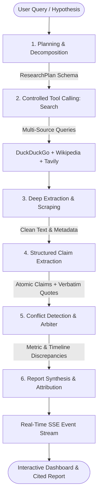

# 🕵️‍♂️ Autonomous Research & Fact-Checking Assistant

> **A tool-using AI agent that searches the web, extracts deep sources, compares atomic claims, flags conflicting evidence, and synthesizes an authoritative, cited intelligence report.**

[](https://python.org)
[](https://fastapi.tiangolo.com)
[](https://langchain.com)
[](LICENSE)

---

## 🎯 The Problem

Manual research on complex, fast-evolving, or controversial topics takes hours and frequently produces inconsistent reports:
- **Search blindness**: Humans often stop after 1 or 2 search queries and miss opposing evidence or dissenting perspectives.
- **Surface-level reading**: Manual browsing relies on top-level snippets rather than extracting and comparing concrete atomic assertions.
- **Unverified contradictions**: Differing statistical baselines, conflicting timelines, and methodology divergences remain unnoticed or unaddressed.
- **Citation fragmentation**: Assertions in human-written summaries frequently lack verifiable, verbatim source attribution.

## 🚀 The Solution: Autonomous Intelligence Agent

This system provides a full-stack, autonomous research and fact-checking agent built on **LangChain**, **FastAPI**, and modern **vanilla web technologies**:



---

## 🔬 Core Architectural Proofs

| Capability | Implementation & Proof in Code |
| :--- | :--- |
| **Tool Calling** | Explicit LangChain `@tool` registered functions (`search_web_tool`, `extract_page_tool`, `verify_claim_tool`) invoked with execution latency tracking, parameter logging, and status auditing. |
| **Planning** | Topic decomposition into analytical dimensions, multi-step search schedules, and proactive counter-hypothesis queries designed to discover dissenting views. |
| **Source Attribution** | Every finding maps to a numbered citation chip (`[1]`, `[2]`), source credibility meter (0–100 based on domain authority), publication date, and verbatim supporting quote. |
| **Controlled Execution** | 6-stage lifecycle state machine with real-time Server-Sent Events (SSE) streaming progress, step transitions, and tool logs to the dashboard. |
| **Structured Outputs** | Strict Pydantic v2 schemas (`ResearchPlan`, `ClaimExtractionResult`, `ConflictAnalysisResult`, `CitedReport`) enforced via `.with_structured_output()`. |

---

## 🛠️ Tech Stack

- **Agent Framework**: LangChain (1.4+), LangChain Core (1.6+), LangChain Groq (`langchain-groq`), LangChain NVIDIA (`langchain-nvidia-ai-endpoints`).
- **Structured Validation**: Pydantic v2 schemas for plans, claims, conflicts, and cited outputs.
- **Search & Scraping Engine**: Multi-tiered search aggregator using DuckDuckGo (`ddgs`), Wikipedia REST API, and optional Tavily API; deep scraping with `httpx` and `BeautifulSoup4`.
- **Backend**: FastAPI with async SSE streaming (`sse-starlette`), thread pool orchestration, and CORS middleware.
- **Frontend**: Responsive single-page dashboard in modern HTML5, CSS3 (glassmorphic dark theme), and vanilla JavaScript with interactive citation hover tooltips and live tool activity console.

---

## 📂 Project Structure

```
├── app/
│   ├── config.py              # Configuration & runtime settings (Groq, NVIDIA, Tavily)
│   ├── main.py                # FastAPI endpoints, background tasks & SSE streaming
│   ├── agent/
│   │   ├── models.py          # Pydantic structured schemas (Plan, Claim, Conflict, Report)
│   │   ├── tools.py           # LangChain search, scrape, and credibility calculation tools
│   │   ├── prompts.py         # Intelligence prompts for planning, claims, and arbiter
│   │   ├── llm_factory.py     # LLM provider builder with structured output enforcement
│   │   └── orchestrator.py    # 6-stage controlled research pipeline & state management
│   └── static/
│       ├── index.html         # Web dashboard UI
│       ├── style.css          # Styling (dark mode, typography, stepper, citation pills)
│       └── app.js             # SSE event listener, interactive tabs, modals & rendering
├── tests/
│   ├── test_agent.py          # Unit tests for tools, models, and orchestrator execution
│   └── test_api.py            # API tests for FastAPI endpoints and quick claim verifier
├── .env.example               # Environment variables template
├── requirements.txt           # Project dependencies
├── run.py                     # Server launch entrypoint
└── README.md                  # System documentation
```

---

## ⚡ Quick Start

### 1. Prerequisites
- Python 3.10+ (tested with Python 3.12)
- Dependencies installed:
  ```bash
  pip install -r requirements.txt
  ```

### 2. Configure Environment (Optional)
Copy `.env.example` to `.env`:
```bash
cp .env.example .env
```
Add your preferred API key (Groq is recommended for ultra-low latency):
```env
LLM_PROVIDER=groq
GROQ_API_KEY=gsk_your_groq_api_key_here
```
> **Note**: Even if you do not set an API key immediately, the application includes an intelligent **Simulated/Demonstration Engine** that allows you to experience the full tool calling, scraping, claim comparison, and conflict detection pipeline offline!

### 3. Run the Application Locally
Launch the server:
```bash
python run.py
```
Or with Uvicorn directly:
```bash
uvicorn app.main:app --host 0.0.0.0 --port 8000 --reload
```

Open your browser to:
👉 **[http://127.0.0.1:8000](http://127.0.0.1:8000)**

---

## 🚀 Render Cloud Deployment

This project includes a turnkey [`render.yaml`](render.yaml) specification for 1-click cloud deployment on [Render](https://render.com):

1. **Push your code to GitHub** (or fork this repository).
2. Log into your **[Render Dashboard](https://dashboard.render.com)**.
3. Click **New +** → **Blueprint**.
4. Connect this GitHub repository. Render will automatically detect [`render.yaml`](render.yaml) and configure:
   - **Environment**: Python 3.12
   - **Build Command**: `pip install -r requirements.txt`
   - **Start Command**: `uvicorn app.main:app --host 0.0.0.0 --port $PORT`
5. Under **Environment Variables**, set your `GROQ_API_KEY` (and optionally `NVIDIA_API_KEY`, `TAVILY_API_KEY`).
6. Click **Apply**. Render will build and deploy the application with a public HTTPS URL.

---

## 🧪 Testing & Verification

Run the comprehensive test suite:
```bash
# Test agent tools, scraping, and orchestrator pipeline
python tests/test_agent.py

# Test FastAPI endpoints and quick fact-check endpoint
python tests/test_api.py
```

---

## 🖥️ Dashboard Features

1. **Autonomous Research Input**:
   - Query input with depth options: Quick (3 sources), Balanced (5 sources), or Deep (8 sources).
   - One-click suggested inquiries on cutting-edge topics.
2. **Interactive Stepper & Live Activity Console**:
   - Visual progress indicator through Planning, Searching, Extracting, Claims, Conflicts, and Synthesis.
   - Collapsible terminal drawer logging tool names, execution latencies (ms), and output summaries.
3. **Cited Intelligence Report**:
   - Clean Markdown rendering with interactive numbered citation pills (`[1]`, `[2]`).
   - Hovering over any citation pill reveals an instant tooltip with the source domain, exact quote, and direct link.
   - One-click **Copy Markdown** and **Download .MD** buttons.
4. **Claim Comparison Matrix**:
   - Atomic claims categorized by stance: `SUPPORTS`, `REFUTES`, `CONDITIONAL`, or `NEUTRAL`.
   - Keyword filtering and extracted quantitative metrics (percentages, dollar amounts, timeline dates).
5. **Conflict Radar**:
   - High-visibility cards highlighting opposing evidence (Perspective A vs Perspective B).
   - Categorized by conflict type: `metric_discrepancy`, `timeline_disagreement`, `methodology_difference`, or `causality_dispute`.
   - Fact-checking Arbiter resolution explaining *why* sources diverge.
6. **Sources & Credibility Inspector**:
   - Evaluates domain authority (e.g. peer-reviewed journals: 90+, government/institutional: 95+, standard press: 80+).
7. **Quick Claim Verifier**:
   - Standalone modal to test a single assertion against live web sources in seconds.
8. **Runtime Settings Modal**:
   - Switch between **Groq**, **NVIDIA AI Endpoints**, or **Demo Mode** directly in the browser UI.

---

## 📄 License
MIT License. Created for advanced autonomous agent workflows.
